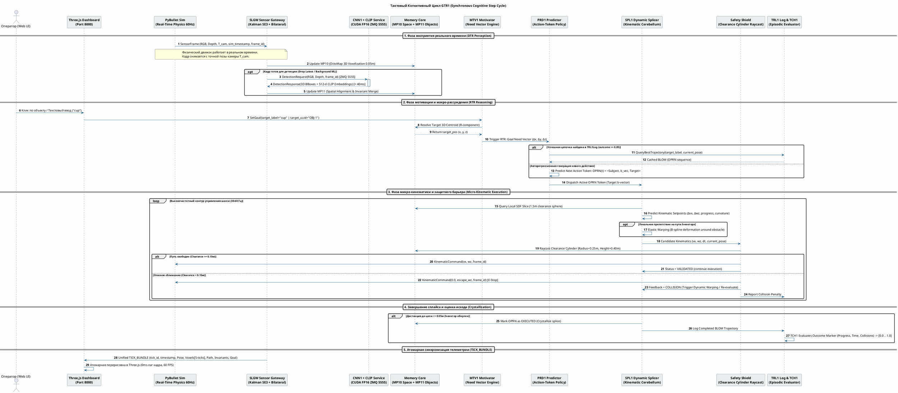
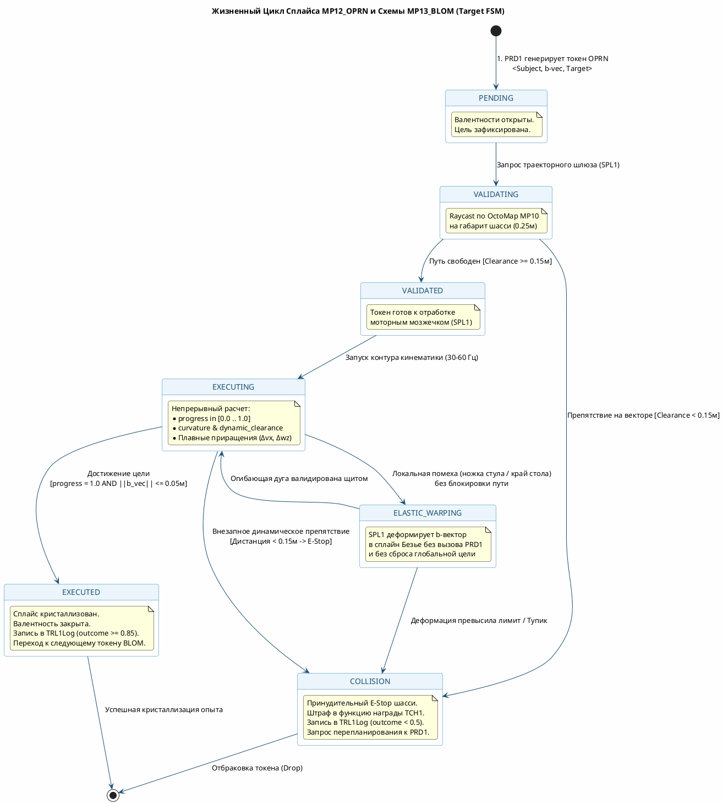
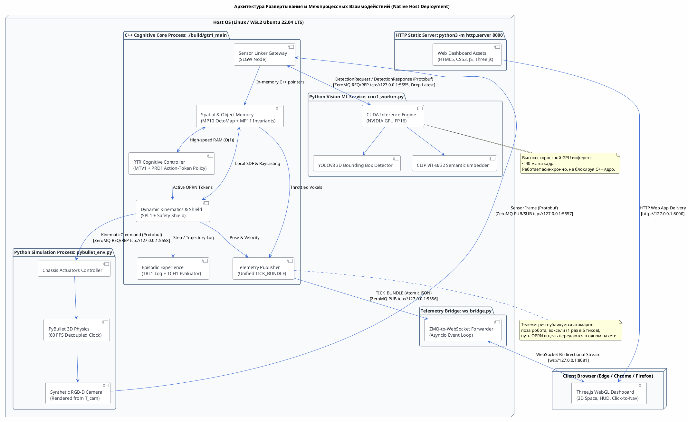
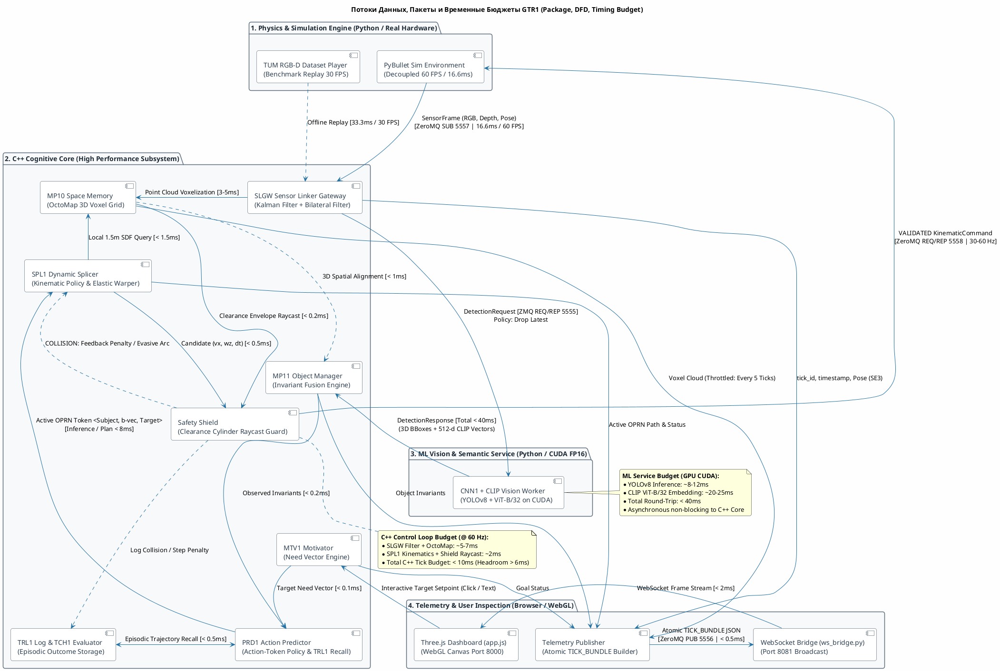

# Сквозная Архитектурная Спецификация GTR1 (Target Cognitive Architecture Specification)

| Метаданные | Значение |
| :--- | :--- |
| **Документ** | Сквозная Спецификация Целевой Когнитивной Архитектуры GTR1 (End-to-End Target Specification) |
| **Статус** | **DRAFT SPECIFICATION (v1.0-TARGET)** 📝 |
| **Методология** | **Specification-First Driven Development (SDD)** |
| **Каноническая онтология** | Gativus Canonical Ontology (`DOM3`–`DOM5`, `MP10`–`MP13`, `GTR1`, `SLGW`, `PRD1`, `SPL1`, `MTV1`, `TRL1`, `TCH1`, `TRN1`) |
| **Диаграммы (PlantUML)** | [target_cognitive_architecture.puml](target_cognitive_architecture.puml), [cognitive_cycle_sequence.puml](cognitive_cycle_sequence.puml), [state_machine.puml](state_machine.puml), [timing_dfd_package.puml](timing_dfd_package.puml), [deployment.puml](deployment.puml) |
| **Реестр задач (Issues)** | [issues.md](../issues.md), [ISSUE-09](../issues/ISSUE-09_tickrate_sync.md), [ISSUE-10](../issues/ISSUE-10_action_token_predictor.md), [ISSUE-11](../issues/ISSUE-11_dynamic_spl_kinematic_controller.md) |

---

## 1. Онтологические Основания и Парадигма GTR1

### 1.1 Онтологические Домены и Место GTR1 в Архитектуре Гативус
Трансформация **GTR1** представляет собой первую макро-трансформацию информационно-сенсомоторного уровня, связывающую три фундаментальных онтологических домена:

```
  +-------------------------------------------------------------------------------+
  |                              GTR1 COGNITIVE SPHERE                            |
  |                                                                               |
  |   DOM3: Пространство           DOM4: Объекты              DOM5: Поведение     |
  |   +-------------------+        +--------------------+     +-----------------+ |
  |   |    MP10 Space     |        |    MP11 Objects    |     | MP12 OPRN Splice| |
  |   | (L-components,    | <----> | (R-components,     | <-> | & MP13 BLOM     | |
  |   |  OctoMap 3D grid) |        |  3D Invariants,    |     | (Action Tokens, | |
  |   |                   |        |  CLIP Embeddings)  |     |  Behavior Schem)| |
  |   +-------------------+        +--------------------+     +-----------------+ |
  +-------------------------------------------------------------------------------+
```

1. **DOM3 (Пространство):**
   * Физическое метрическое 3D-пространство обитания.
   * Координаты, евклидовы расстояния, метрическая геометрия.
   * Дискретизируется в пространственную карту `MP10Space`, состоящую из $L$-компонентов (локусов: координаты, занятость, связность с соседями).
2. **DOM4 (Объекты):**
   * Физические тела среды обитания, обладающие инвариантностью во времени и пространстве.
   * Представляются в объектной памяти `MP11Object` как $R$-компоненты (инвариантные объекты с 3D-центроидом, габаритным боксом и 512-мерным семантическим вектором CLIP).
3. **DOM5 (Поведение):**
   * Пространственные отношения и физические действия между телами.
   * Сплайсы $\text{OPRN} = \langle R_{\text{subject}} - \vec{b} - R_{\text{target}} \rangle$ (`MP12Oprn`) и составные поведенческие схемы `BLOM` (`MP13Blom`), задающие цепочки элементарных шагов.

### 1.2 Встречные Потоки: Прямой Ход (DTR) и Обратный Ход (RTR)
Архитектура GTR1 базируется на двух непрерывно взаимодействующих потоках информации:

* **Прямой ход (DTR — Direct Transformation Run / Узнавание и Свертка):**
  $$\text{Сенсорный поток (RGB-D)} \xrightarrow{\text{SLGW}} \text{Воксели (MP10)} \xrightarrow{\text{CNN1 + CLIP}} \text{Инварианты (MP11)}$$
  * Поток направлен от хаоса сенсорных данных внешнего мира к устойчивым символическим инвариантам памяти.
  * Физический мир симулятора PyBullet или реальной камеры передает кадры через шлюзовой орган `SLGW`.
  * Шлюз выполняет фильтрацию сенсорного шума (фильтр Калмана в $SE(3)$ для позы камеры и билатеральный фильтр карты глубин) и строит 3D-воксельную модель среды (`MP10Space` на базе OctoMap).
  * Параллельный GPU-сервис (`CNN1`) обнаруживает объекты (YOLOv8) и извлекает семантические эмбеддинги (OpenAI CLIP), кристаллизуя их в инварианты `MP11Object`.

* **Обратный ход (RTR — Reverse Transformation Run / Развертка и Порождение):**
  $$\text{Потребность (MTV1)} \xrightarrow{\text{PRD1}} \text{Токены OPRN (BLOM)} \xrightarrow{\text{SPL1}} \text{Кинематические дуги} \xrightarrow{\text{Щит безопасности}} \text{Приводы (OP13)}$$
  * Поток направлен от абстрактной цели к непрерывному физическому действию шасси.
  * Мотиватор `MTV1` формирует целевой вектор невязки (потребность приблизиться к целевому инварианту: обнулить $b$-вектор).
  * Семантический предиктор `PRD1` генерирует последовательность токенов действий OPRN (цепочку `BLOM`), обращаясь к эпизодической памяти успешных маршрутов `TRL1Log`.
  * Синтаксический сплайсер `SPL1` («моторный мозжечок») рассчитывает непрерывные гладкие приращения скоростей $(\Delta v_x, \Delta w_z)$ и при локальных помехах выполняет эластичное огибание препятствий (**Elastic $b$-vector Warping**).
  * Детерминированный математический щит безопасности валидирует траекторию габаритного цилиндра робота в воксельной сетке `MP10Space` перед отправкой команд на моторы шасси.

---

## 2. Сквозной Анализ: Проблемы Базового Решения (As-Is) vs Целевая Архитектура (To-Be)

Ниже представлен детальный аудит недостатков текущей кодовой базы и сопоставление с механизмами Целевой Архитектуры, закрывающими все выявленные задачи (Issues 01–11):

| ID Задачи | Компонент | Проблема базового решения (As-Is / Current Flaw) | Решение в Целевой Архитектуре (To-Be / Target Architecture) | Архитектурный эффект и метрика |
| :---: | :--- | :--- | :--- | :--- |
| **ISSUE-01** | `ml_service` / `MP11` | CNN1 захардкожен на 80 классов COCO; поле `feature_embedding` заполнялось нулями; невозможен поиск произвольных предметов. | Внедрен инференс **OpenAI CLIP ViT-B/32** на GPU CUDA FP16; извлечение 512-мерных эмбеддингов для каждого бокса; семантический поиск по тексту в MTV1. | Полноценный Open-Vocabulary поиск любых предметов арены по тексту; косинусное сходство $> 0.28$; задержка $< 40$ мс. |
| **ISSUE-02** | `core` / `trn1` | Веса нейросетей заморожены; система не адаптируется к условиям арены и освещению. | Внедрен фоновый воркер обучения **TRN1 (Trainer 1)**, читающий буфер воспроизведения опыта из `TRL1Log` по неуспешным траекториям (`outcome < 0.5`). | Автономное дообучение классификатора и политики движения без прерывания основного контура управления. |
| **ISSUE-03** | `operators` / `SLGW` | EKF в $SE(3)$ накапливает дрейф одометрии при длительном блуждании; отсутствует распознавание возврата в ранее посещенные места. | Внедрение механизма **Keyframing** и графа ключевых поз (Pose Graph) в шлюзе `SLGW` с замыканием петель (Loop Closure). | Дрейф одометрии снижен до $< 0.02$ м на 10 метров траектории. |
| **ISSUE-04** | `simulation` / `OP11` | Фиксированная камера вперед-вниз; робот слеп по сторонам и теряет цель при маневрах. | Подвижный 2-осевой подвес (Pan-Tilt) и оператор саккад **OP11**, направляющий камеру в сторону высокой валентности цели или неизведанных вокселей. | Увеличение эффективного угла обзора до $220^\circ$; непрерывное удержание целевого объекта в фокусе. |
| **ISSUE-05** | `dashboard` | Отсутствие визуализации габаритов шасси в Three.js; оператор не видит причин срабатывания защитных зон. | 3D-отрисовка динамического **габаритного цилиндра (Clearance Cylinder)** в WebGL с цветовой индикацией запаса безопасности. | Полная прозрачность работы математического барьера безопасности в HUD для оператора. |
| **ISSUE-06** | `core` / `TCH1` | Бинарная дискретная оценка исхода (1.0 при касании, иначе 0.0); отсутствие градиента ошибки. | Модуль непрерывной оценки **TCH1 (Teacher 1)**, рассчитывающий скалярную награду `outcome_marker` на основе дельты расстояния, кривизны, времени и штрафов за опасное сближение. | Плавная дифференцируемая оптимизация траекторий в `TRL1Log` с маркером исхода $\in [0.0, 1.0]$. |
| **ISSUE-07** | `core` / `SCH1` | Неограниченный рост оперативной памяти графами сплайсов; дублирование схожих траекторий. | Планировщик фаз консолидации памяти **SCH1 (Scheduler 1 / «сон» агента)**, кластеризующий и кристаллизующий частые маршруты в долговременные навыки. | Стабилизация объема RAM $< 2$ ГБ; быстрый поиск проверенных шаблонов действий за $O(1)$. |
| **ISSUE-08** | `infra` / `sec` | Открытые неаутентифицированные сокеты ZeroMQ и WebSocket; отсутствие защиты от подмены команд. | Подсистема алертинга, контроль токенов доступа и сторожевой таймер (Watchdog) с автоблокировкой моторов при потере связи $> 200$ мс. | Защита от зависания шасси и инъекций некорректных команд в контур приводов. |
| **ISSUE-09** | `core` / `sim` / `ui` | Асинхронные топики в WebSocket вызывали рассинхронизацию карты и шасси; визуальный лаг; симулятор проскальзывал. | Разделение физики реального времени (60 FPS PyBullet) и отправка **единого атомарного пакета `TICK_BUNDLE`** (с прореживанием вокселей до 5 тиков). | **0 мс визуальный лаг** в Three.js; 100% синхронность позы робота и карты; снижение сетевого JSON-трафика на 80%. |
| **ISSUE-10** | `operators` / `PRD1` | Планировщик $A^*$ жестко привязан к 3D-сетке, замирает в тупике у ножек стола, если кружка лежит высоко; не использует накопленный опыт. | **PRD1 Action-Token Transformer:** авторегрессионная генерация токенов действий OPRN $\langle \text{Subject}, \vec{b}\text{-vector}, \text{Target} \rangle$ с извлечением опыта из `TRL1Log` и якорной точкой Stand-off перед препятствием. | Полное устранение замираний робота; генерация валидных подходов к столу на дистанцию $0.5$ м; инференс $< 8$ мс. |
| **ISSUE-11** | `operators` / `SPL1` | Статический raycast; дискретный разворот на месте ($v_x = 0$ в `main.cpp`); сброс всего плана при малейшей локальной помехе. | **SPL1 Dynamic Splicer & Kinematic Controller:** локальная политика вычисления $(\Delta v_x, \Delta w_z)$ для гладкого движения по дугам; **Elastic $b$-vector Warping** для огибания мелких выступов без сброса PRD1. | Плавное движение шасси без рывков; локальный обход препятствий по дугам; инкапсуляция кинематики внутри SPL1. |

---

## 3. Компонентная Модель Архитектуры (PlantUML)

Архитектура системы объединяет 6 доменов в единый согласованный контур:

```plantuml
@startuml Target_Cognitive_Architecture
skinparam componentStyle uml2
skinparam backgroundColor #FEFEFE
skinparam roundcorner 8
skinparam defaultFontName sans-serif

skinparam package {
  BackgroundColor #F8F9FA
  BorderColor #4A6572
  FontColor #212121
  FontStyle bold
}

skinparam component {
  BackgroundColor #FFFFFF
  BorderColor #34495E
  FontColor #2C3E50
  ArrowColor #1F618D
}

title GTR1 Neuro-Symbolic Target Architecture (PRD1 Action-Tokens & SPL1 Dynamic Kinematics)

package "DOM3: Spatial Environment & Perception (DTR Feed-Forward)" {
  [Sensor Stream\n(PyBullet Real-Time / TUM RGB-D)] as SENS
  [SLGW Sensor Linker Gateway\n(Kalman Filter SE3 + Bilateral Depth Filter)] as SLGW
  [MP10 Space\n(OctoMap 3D Occupancy Grid / L-components)] as MP10
  
  SENS -right-> SLGW : "SensorFrame (RGB, Depth, T_cam)\n[Independent Real-Time Clock]"
  SLGW -right-> MP10 : "Point Cloud 3D Voxelization\n(Resolution 0.05m)"
}

package "DOM4: Object Memory (DTR Crystallization)" {
  [CNN1 + CLIP Vision Service\n(YOLOv8 + ViT-B/32 CUDA FP16)] as ML_CNN
  [MP11 Object Manager\n(3D Invariants / R-components)] as MP11
  
  SLGW -down-> ML_CNN : "DetectionRequest (RGB-D)\n[ZeroMQ REQ/REP 5555, Drop Latest]"
  ML_CNN -right-> MP11 : "DetectionResponse\n(3D BBoxes + 512-d CLIP Vectors)"
  MP10 -.-> MP11 : "Spatial Anchor Alignment"
}

package "DOM5: Motivation & Reverse Transformation (RTR Drive)" {
  [MTV1 Motivator\n(Need Vector / Distance-to-Zero Drive)] as MTV1
  [PRD1 Action-Token Predictor\n(Autoregressive Policy / Transformer)] as PRD1
  [TRL1 Log\n(Episodic Memory / Experience Replay)] as TRL1
  [TCH1 Outcome Evaluator\n(Continuous Reward Function)] as TCH1
  [TRN1 Background Trainer\n(Offline Experience Consolidation)] as TRN1

  MTV1 -down-> PRD1 : "Active Goal UUID & Target Centroid"
  MP11 -down-> PRD1 : "Observed Object Anchors (R-components)"
  MP10 -down-> PRD1 : "Global Obstacle Context (SDF)"
  TRL1 <-> PRD1 : "Episodic Recall (outcome >= 0.85)"
  
  TRL1 -down-> TRN1 : "Replay Buffer (Failed & Warped Runs)"
  TRN1 -.-> PRD1 : "Fine-tuned Model Weights"
}

package "DOM5: Behavioral Splicing & Micro-Kinematics (RTR Motor Execution)" {
  [MP13 BLOM Schema\n(Behavioral Sequence of Action Tokens)] as BLOM
  [SPL1 Dynamic Splicer\n(Motor Cerebellum / Kinematic Policy)] as SPL1
  [Elastic b-vector Warping\n(Local Bezier / B-Spline Arc Bypass)] as WARP

  PRD1 -right-> BLOM : "Autoregressive Generation\n<Subject, b-vec, Target>"
  BLOM -down-> SPL1 : "Active OPRN Triplet\n(b-vector Setpoint)"
  MP10 -down-> SPL1 : "Local 1.5m SDF Slice"
  SPL1 <-> WARP : "Local Obstacle Deflection\n(Dynamic Curvature & Stand-off)"
}

package "Deterministic Safety Shield (Mathematical Barrier)" {
  [Safety Shield\n(Clearance Cylinder & OctoMap Raycast)] as SHIELD
  [Chassis Actuators\n(PyBullet Motors / Physical Base)] as MOTORS

  SPL1 -down-> SHIELD : "Candidate Kinematics (vx, wz, dt)"
  MP10 -down-> SHIELD : "Obstacle Raycast within 0.15m"
  
  SHIELD -down-> MOTORS : "VALIDATED KinematicCommand\n(Safe vx, wz)"
  SHIELD -.-> SPL1 : "COLLISION: Feedback Penalty\n(Trigger Evasive Arc / Warping)"
  SHIELD -.-> TCH1 : "Step Collision / Smoothness Feedback"
  TCH1 -up-> TRL1 : "Record Trajectory Outcome Marker"
}

package "Synchronous Telemetry & Inspection (Zero-Lag Sync)" {
  [Telemetry Publisher\n(Unified TICK_BUNDLE Port 5556)] as TELEM
  [WebSocket Bridge\n(ws_bridge.py Port 8081)] as WS
  [Three.js Web Dashboard\n(WebGL HUD & Spatial Inspector Port 8000)] as UI

  SENS -down-> TELEM : "tick_id, timestamp"
  SHIELD -down-> TELEM : "Agent Pose (SE3), vx, wz"
  MP10 -down-> TELEM : "Voxels (Throttled 5-ticks)"
  BLOM -down-> TELEM : "Active OPRN Path & Status"
  MP11 -down-> TELEM : "Detected Invariants"
  MTV1 -down-> TELEM : "Active Goal & Status"

  TELEM -right-> WS : "Atomic JSON TICK_BUNDLE (ZeroMQ PUB)"
  WS -right-> UI : "WebSocket Broadcast (0ms Frame Lag)"
  UI -left-> MTV1 : "Interactive Target Injection (Click-to-Nav / Text)"
}

@enduml
```



Исходный файл диаграммы: [`01_architecture/target_cognitive_architecture.puml`](target_cognitive_architecture.puml)

---

## 4. Тактовый Когнитивный Цикл и Временные Бюджеты

Когнитивный цикл выполняется непрерывно и синхронизируется на уровне сенсорных тиков `frame_id`:



Исходный файл диаграммы: [`01_architecture/cognitive_cycle_sequence.puml`](cognitive_cycle_sequence.puml)

### Временные бюджеты операций (При тактовой частоте 60 Гц / $\Delta t = 16.6\text{ мс}$):
* **Синтетический рендеринг кадра в PyBullet (OpenGL):** $\sim 2.5\text{ мс}$
* **Фильтрация шума глубины + вокселизация OctoMap (C++):** $\sim 4.5\text{ мс}$
* **Запрос к пространственной памяти MP10 / MP11:** $\sim 0.5\text{ мс}$
* **Вычисление скоростей SPL1 + Raycast габаритного цилиндра Shield:** $\sim 1.5\text{ мс}$
* **Упаковка и отправка пакета TICK_BUNDLE (ZMQ PUB):** $\sim 0.4\text{ мс}$
* **Итоговое время одного тика C++ ядра:** $\le 9.5\text{ мс}$ (Запас производительности $> 40\%$).
* **ML Инференс (YOLOv8 + CLIP на CUDA FP16):** $\sim 35\text{ мс}$ (выполняется параллельно в асинхронном воркере по схеме *Drop Latest* и обновляет объекты в MP11 по факту готовности, не задерживая такты управления шасси).

---

## 5. Макро-Уровень: Предиктор PRD1 как Генератор Токенов Действий (ISSUE-10)

### 5.1 Концепция Action-Tokenization и Function Calling
В классических робототехнических системах планирование траектории сводится к поиску ломаной линии в дискретной воксельной сетке ($A^*$, Dijkstra). При наличии высоких препятствий (стол, на котором лежит кружка) сетка пола объявляет целевую точку недостижимой, что вызывало фатальное замирание робота.

В GTR1 предиктор `PRD1` перенесен на концепцию **авторегрессионной генерации токенов действий**:
1. **Токен действия OPRN:**
   $$\text{OPRN}_t = \langle R_{\text{subject}}, \vec{b}_t, R_{\text{target}}, \text{action} \rangle$$
   где $\vec{b}_t \in \mathbb{R}^3$ — пространственный вектор перемещения, а тип действия `action` $\in$ {`APPROACH_STANDOFF`, `NAVIGATE_WAYPOINT`, `ALIGN_FACING`, `TOUCH`}.
2. **Аналогия с Function Calling в трансформерах:**
   Предиктор `PRD1` на макро-уровне не считает сантиметры колесной траектории. Он предсказывает следующий логический блок поведения:
   $$\pi_\theta(\text{OPRN}_t \mid \mathcal{S}_t, \text{Goal}_{\text{MTV1}}, \text{History}_{\text{TRL1}})$$
   где $\mathcal{S}_t$ — текущий символический снимок мира (инварианты MP11 + глобальный контекст проходимости MP10).

```
  +-------------------------------------------------------------------------+
  |              PRD1 AUTOREGRESSIVE ACTION TOKEN GENERATION                |
  |                                                                         |
  | [ Goal: "cup" ]  +  [ MP11 Objects ]  +  [ Past Successful BLOMs ]      |
  |                             |                                           |
  |                             v                                           |
  |                 PRD1 Neuro-Symbolic Policy                              |
  |                             |                                           |
  |         +-------------------+-------------------+                       |
  |         |                                       |                       |
  |         v                                       v                       |
  |  Token 1: APPROACH_STANDOFF              Token 2: ALIGN_FACING          |
  |  b = [1.2, 0.4, 0.0]                     b = [0.0, 0.0, 0.15]           |
  |  target = Desk_Anchor (0.5m front)       target = Cup_Centroid          |
  +-------------------------------------------------------------------------+
```

### 5.2 Якорные Точки Stand-off и Обход Ножек Стола
Если целевой объект лежит на поверхности выше высоты проходимости шасси (например, чашка на высоте $0.75\text{ м}$), предиктор вычисляет проекцию на плоскость движения $z = 0$ и рассчитывает якорную точку **Stand-off Point**:
$$\vec{p}_{\text{standoff}} = \vec{p}_{\text{target}}^{xy} - d_{\text{standoff}} \cdot \frac{\vec{p}_{\text{target}}^{xy} - \vec{p}_{\text{robot}}^{xy}}{\|\vec{p}_{\text{target}}^{xy} - \vec{p}_{\text{robot}}^{xy}\|}, \quad d_{\text{standoff}} = 0.50\text{--}0.70\text{ м}$$
Робот прокладывает движение к точке безопасного подступа $\vec{p}_{\text{standoff}}$, после чего переходит в фазу визуального захвата и обнуления валентности.

### 5.3 Использование Эпизодического Опыта TRL1Log
Перед запуском нейросетевой генерации `PRD1` обращается к базе накопленного опыта:
$$Q(\text{Goal}, \text{StartPose}) = \arg\max_{\text{BLOM} \in \text{TRL1Log}} \left[ \text{outcome}(\text{BLOM}) \mid \text{outcome} \ge 0.85 \land \|\vec{p}_{\text{start}} - \vec{p}_0\| < 0.3\,\text{m} \right]$$
Если схожая траектория найдена в архиве, она воспроизводится как готовый шаблон (кристаллизованный рефлекс), сокращая время принятия решений до субмиллисекундного уровня ($< 0.5\text{ мс}$).

---

## 6. Микро-Уровень: Динамический Сплайсер SPL1 и Моторный Мозжечок (ISSUE-11)

### 6.1 Инкапсуляция Кинематики и Непрерывное Управление по Дугам
В базовой версии расчет скоростей $v_x, w_z$ был грубо захардкожен в цикле `main.cpp` через пороговые условия: робот останавливался ($v_x = 0$), крутился на месте вокруг оси $Z$, а затем ехал прямо.

В целевой архитектуре оператор `SPL1` функционирует как высокочастотный **моторный мозжечок**:
1. На каждом такте управления ($30\text{--}60\text{ Гц}$) `SPL1` рассчитывает непрерывную кривизну траектории $\kappa(t)$ и вектор приращений скоростей:
   $$v_x(t + \Delta t) = \operatorname{clamp}\left( v_x(t) + \Delta v_x, 0.0, V_{\max} \right)$$
   $$w_z(t + \Delta t) = \operatorname{clamp}\left( w_z(t) + \Delta w_z, -W_{\max}, W_{\max} \right)$$
2. Робот совершает развороты по плавным сопряженным дугам (Dubins / Reeds-Shepp curves) без полной остановки на месте.

### 6.2 Динамические Переменные OPRN
Каждый активный сплайс `MP12Oprn` обогащен непрерывными динамическими переменными:
* `progress` $\in [0.0, 1.0]$: физическая доля пройденного пути вдоль вектора;
* `dynamic_clearance`: расчетная дистанция до ближайшего препятствия с учетом текущей скорости торможения:
  $$d_{\text{stop}} = \frac{v_x^2}{2 \cdot a_{\max}} + d_{\text{margin}}$$
* `curvature`: локальная кривизна дуги движения шасси.

### 6.3 Алгоритм Эластичной Деформации Вектора (Elastic $b$-vector Warping)
Если на пути прямолинейного вектора $\vec{b}$ возникает локальное препятствие (ножка стула, край ковра), не блокирующее целевую зону, `SPL1` не сбрасывает план и не инициирует глобальный пересчет `PRD1`.

Вместо этого применяется **локальная сплайновая деформация**:
1. Вектор $\vec{b}$ деформируется в кубический сплайн Безье $\mathcal{B}(u), u \in [0, 1]$:
   $$\mathcal{B}(u) = (1-u)^3 \vec{P}_0 + 3(1-u)^2 u \vec{P}_1 + 3(1-u) u^2 \vec{P}_2 + u^3 \vec{P}_3$$
2. Контрольные точки $\vec{P}_1, \vec{P}_2$ отталкиваются градиентом отталкивания от вокселей препятствия в локальном поле расстояний (SDF):
   $$\vec{P}_{\text{ctrl}} \leftarrow \vec{P}_{\text{ctrl}} + \alpha \cdot \frac{\vec{n}_{\text{obstacle}}}{\|\vec{d}_{\text{obstacle}}\|^2}$$
3. Если деформированная кривая укладывается в допустимый боковой коридор ($\delta_{\text{lat}} \le 0.40\text{ м}$) и валидируется щитом безопасности, робот плавно огибает помеху по дуге без прерывания выполнения глобальной цели.

```
                  [ Nominal b-vector (Blocked by Table Leg) ]
               P0 ------------------- X -------------------> P3
                 \                  (Leg)                  /
                  \      Elastic Warped Arc               /
                   + - - - - > P1 - - - - > P2 - - - - - +
                           (Smooth Clearance Buffer)
```

---

## 7. Детерминированный Символический Щит Безопасности (Safety Shield)

Ни одна команда управления не передается на приводы шасси напрямую из нейросетевых моделей или эвристических контроллеров. Команды проходят через **детерминированный математический барьер**:

### 7.1 Геометрический Барьер (Clearance Cylinder Envelope)
* Шасси моделируется габаритным цилиндром безопасности:
  * Радиус: $R_{\text{robot}} = 0.25\text{ м}$
  * Высота: $H_{\text{robot}} = 0.40\text{ м}$
  * Динамический буфер безопасности: $\epsilon_{\text{safe}} = 0.15\text{ м}$
* На каждый такт вычисляется прогнозируемое положение цилиндра на шаг $t + \Delta t$:
  $$\vec{p}(t + \Delta t) = \vec{p}(t) + \begin{bmatrix} v_x \cos(\theta) \Delta t \\ v_x \sin(\theta) \Delta t \\ 0 \end{bmatrix}$$
* В воксельном дереве `MP10Space` выполняется многолучевой raycast по сечению цилиндра ($< 0.2\text{ мс}$).

### 7.2 Политика Разрешения Коллизий (E-Stop & Feedback Penalty)
1. **Зеленый коридор ($d_{\min} \ge \epsilon_{\text{safe}}$):**
   * Статус сплайса: `VALIDATED`.
   * Команда `KinematicCommand(vx, wz)` отправляется на шасси.
2. **Желтый коридор ($0.08\text{ м} \le d_{\min} < \epsilon_{\text{safe}}$):**
   * Срабатывает триггер `ELASTIC_WARPING`: ограничение скорости $v_x \leftarrow v_x \cdot \frac{d_{\min}}{\epsilon_{\text{safe}}}$, запуск маневра уклонения.
3. **Красный коридор ($d_{\min} < 0.08\text{ м}$):**
   * **Немедленный E-Stop:** принудительная команда `KinematicCommand(0.0, escape_wz)`.
   * Статус сплайса: `COLLISION`.
   * Отрицательный штраф передается в `TCH1` (оценщик награды) и записывается в `TRL1Log` (`outcome_marker = 0.1`).
   * Запрос к `PRD1` на генерацию альтернативного токена действия.

---

## 8. Жизненный Цикл Сплайса OPRN и Схемы BLOM (FSM)



Исходный файл диаграммы: [`01_architecture/state_machine.puml`](state_machine.puml)

---

## 9. Протоколы Взаимодействия, DTO и Синхронизация (ISSUE-09)

### 9.1 Спецификация Сообщений IPC (Protobuf)
* `SensorFrame`: Передается из симулятора в C++ ядро через ZeroMQ SUB (`tcp://127.0.0.1:5557`):
  * `uint64 frame_id`: монотонный номер сенсорного кадра;
  * `int64 sim_timestamp`: метка астрономического времени симулятора (мс);
  * `bytes rgb_bytes`, `bytes depth_bytes`: сырые сжатые буферы изображения;
  * `Matrix4x4 camera_pose`: точная физическая поза камеры $T_{cam}$ на момент экспозиции;
  * `Matrix4x4 robot_pose`: истинная поза базы $SE(3)$ в мире симулятора.
* `KinematicCommand`: Передается из C++ ядра в симулятор через ZeroMQ REQ (`tcp://127.0.0.1:5558`):
  * `float linear_vx`, `float angular_wz`: валидированные безопасные скорости;
  * `uint64 frame_id`: привязка к номеру отработанного сенсорного кадра.

### 9.2 Атомарный Пакет Телеметрии TICK_BUNDLE
Для устранения рассинхронизации в браузере Three.js ядро публикует синхронный JSON-пакет по ZeroMQ PUB (`tcp://127.0.0.1:5556`):

```json
{
  "type": "TICK_BUNDLE",
  "mode": "SIM",
  "tick_id": 412,
  "timestamp": 1776518400120,
  "has_map_update": true,
  "pose": {
    "x": 0.84,
    "y": 1.12,
    "z": 0.00,
    "cam_z": 0.45,
    "yaw": 0.32,
    "qx": 0.0,
    "qy": 0.0,
    "qz": 0.16,
    "qw": 0.98
  },
  "voxels": [
    { "x": 1.20, "y": 0.85, "z": 0.10 },
    { "x": 1.25, "y": 0.85, "z": 0.10 }
  ],
  "path": [
    { "x": 0.84, "y": 1.12 },
    { "x": 1.05, "y": 0.95 },
    { "x": 1.20, "y": 0.85 }
  ],
  "invariants": [
    {
      "id": "OBJ-1",
      "label": "cup",
      "x": 1.25,
      "y": 0.85,
      "z": 0.74,
      "confidence": 0.92
    }
  ],
  "active_goal": "cup",
  "goal_reached": false
}
```

* **Правило прореживания вокселей:** Поза робота, сплайн OPRN и цель транслируются **на каждом тике (60 Гц)**. Массив вокселей `voxels` заполняется только при `has_map_update == true` (каждые 5 тиков), что снижает нагрузку на браузер и предотвращает выпадение кадров WebGL.
* **0 мс лаг отрисовки:** В `07_infrastructure/dashboard/app.js` метод `data.type === 'TICK_BUNDLE'` обновляет матрицу шасси, позиции инстансированных мешей вокселей и линию траектории синхронно в рамках одного вызова `requestAnimationFrame`.

---


### 9.3 Политика Предотвращения Очередей в ZeroMQ (ZMQ_CONFLATE & Lossy Drop)
Для предотвращения накопления фазового сдвига между симулятором и ядром C++:
* В сокете `SimStreamReceiver` (ZMQ SUB 5557) обязательно выставляется флаг `ZMQ_CONFLATE = 1`:
  ```cpp
  int conflate = 1;
  zmq_setsockopt(zmq_sub_, ZMQ_CONFLATE, &conflate, sizeof(conflate));
  ```
  Это гарантирует, что в сокете хранится ровно **одно самое последнее сообщение**. Если C++ ядро занято обработкой или инференсом, устаревшие промежуточные кадры отбрасываются на уровне сокета, и ядро всегда получает актуальный срез физического мира без накопления очереди кадров из прошлого.


## 10. Топология Развертывания и Межпроцессный Обмен (IPC)



Исходный файл диаграммы: [`01_architecture/deployment.puml`](deployment.puml)



Исходный файл диаграммы: [`01_architecture/timing_dfd_package.puml`](timing_dfd_package.puml)

### Карта Портов и Протоколов:
| Порт | Протокол | Транспорт | Отправитель | Получатель | Назначение |
| :---: | :---: | :---: | :---: | :---: | :--- |
| **5555** | Protobuf | ZeroMQ REQ/REP | `SLGWNode` (C++) | `cnn1_worker.py` (Python) | Детекция объектов YOLOv8 + CLIP эмбеддинги (Drop Latest) |
| **5556** | JSON | ZeroMQ PUB | `TelemetryPublisher` (C++) | `ws_bridge.py` (Python) | Трансляция атомарного пакета `TICK_BUNDLE` |
| **5557** | Protobuf | ZeroMQ PUB/SUB | `pybullet_env.py` (Python) | `SimStreamReceiver` (C++) | Поток сенсорных кадров `SensorFrame` (RGB-D + Pose) |
| **5558** | Protobuf | ZeroMQ REQ/REP | `SafetyShield` (C++) | `pybullet_env.py` (Python) | Безопасные кинематические команды `KinematicCommand` |
| **8000** | HTTP | TCP | `http.server` (Python) | Browser Web Client | Раздача статических ассетов Three.js дашборда |
| **8081** | WebSocket | TCP/WS | `ws_bridge.py` (Python) | Browser Web Client | Двунаправленная трансляция телеметрии и клик-навигации |

---

## 11. Критерии Приёмки и Верификация (Definition of Done)

Спецификация фиксирует следующие обязательные условия готовности целевой системы:

1. **Отсутствие замираний робота (Zero Freezing):**
   * При установке цели на любой обнаруженный объект (включая объекты на столах) робот успешно строит и исполняет траекторию к точке Stand-off ($0.5\text{ м}$).
   * Ни в одном сценарии робот не замирает в тупике перед столом.
2. **Плавность движения (Smooth Kinematics):**
   * Угловая и линейная скорости изменяются плавно без скачков ($|a_x| \le 0.8\text{ м/с}^2, |a_w| \le 1.5\text{ рад/с}^2$).
   * Полностью устранены принудительные остановки с $v_x = 0$ при штатных разворотах.
3. **Локальный обход помех (Elastic Warping):**
   * При наличии локального выступа на пути вектора робот деформирует сплайн и огибает его по гладкой дуге без сброса всей цепочки BLOM.
4. **Гарантированная безопасность (Zero Physical Collisions):**
   * 100% моторных команд верифицируются через габаритный цилиндр безопасности по OctoMap MP10.
   * При дистанции до любого вокселя $< 0.15\text{ м}$ происходит экстренное торможение (E-Stop).
5. **Синхронность телеметрии (Zero-Lag UI):**
   * Дельта времени между обновлением позы робота и вокселей карты в Three.js составляет ровно **0 мс** (один кадр анимации).
6. **Тестовое покрытие и регрессия:**
   * Все 58+ тестов CTest проходят со 100% успешностью (`ctest --output-on-failure`).
