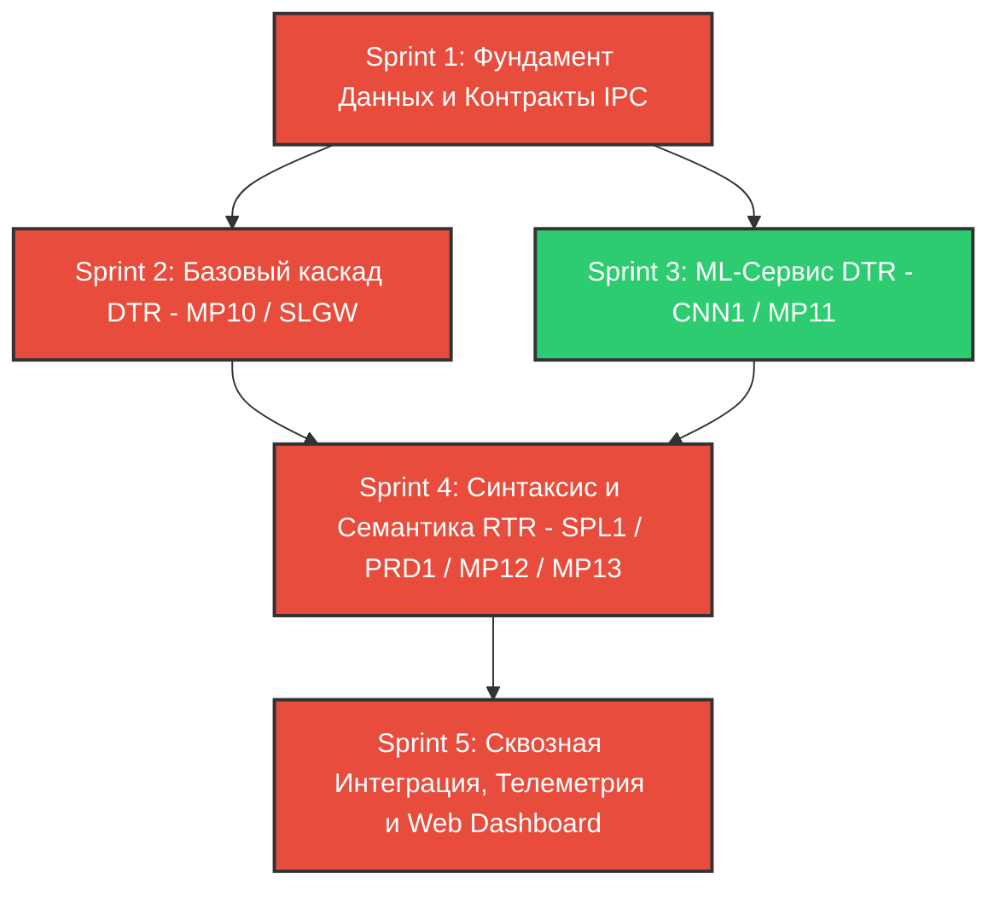

# Дорожная карта проекта GTR1 (MVP Simulation)

## 1. Введение и Архитектурный Контекст
Данный документ фиксирует дорожную карту реализации минимально жизнеспособной симуляции (MVP) первой информационно-сенсомоторной трансформации (GTR1) в когнитивной архитектуре Гативус.

Цель проекта: развернуть замкнутый биоморфный контур управления поведением:
- **Прямой ход (DTR / Свёртка):** Сенсорный поток (RGB-D) $\to$ Воксельное пространство (`MP10Space`) $\to$ Инвариантные объекты (`MP11Object`).
- **Обратный ход (RTR / Развёртка):** Физиологическая цель (`MTV1Goal`) $\to$ Семантическое планирование графа (`PRD1` $\to$ `MP13Blom`) $\to$ Синтаксическая валидация проходимости (`SPL1` $\to$ `MP12Oprn`) $\to$ Генерация моторных команд (`OP13`).

### Инженерный базис (ADR 001):
1. **Топология:** Нативное выполнение на хост-системе (Linux/WSL2) без Docker-контейнеризации (ADR 001), бессерверный бинарный IPC через ZeroMQ (REQ/REP + PUB/SUB). ROS 2 исключен для минимизации инфраструктурного оверхеда.
2. **Стек:** C++17 Core (Eigen3, OctoMap, OpenCV, ZeroMQ, Protobuf) + Python 3.10 ML Service (YOLOv8, CLIP, WebSockets).
3. **Среда:** Оффлайн воспроизведение записанного датасета TUM RGB-D (`freiburg1_desk`), эмуляция реального времени 30 FPS.
4. **Backpressure:** Политика "Drop Latest" (потеря промежуточных кадров во избежание лага инференса ML).
5. **Опыт (TRL1):** Высокоскоростное in-memory хранилище графов с дофаминовыми маркерами исхода.

---

## 2. Анализ Зависимостей и Критический Путь



### Матрица блокировок:
1. **Sprint 1 блокирует всё:** Невозможно разрабатывать узлы `SLGW`, `CNN1`, `SPL1`, `PRD1` без утвержденных сериализуемых протоколов (`gtr1_structures.proto`, `ipc_messages.proto`) и C++ доменных интерфейсов (`ValiBase`, `MP10Space`, `MP11Object`, `MP12Oprn`, `MP13Blom`, `TRL1Log`).
2. **Sprint 2 блокирует геометрический тест Sprint 4:** Синтаксический предиктор (`SPL1`) не способен валидировать $b$-векторы raycast-тестом, пока `OctoMapManager` не формирует воксельную сетку пространства `MP10`.
3. **Sprint 3 блокирует сборку сплайсов Sprint 4:** Сплайс `MP12Oprn` — это связка Субъекта и Цели. Пока детекция `CNN1` и менеджер слияния `MP11Manager` не выдают валидные инварианты, предиктору не к чему прокладывать путь.
4. **Sprint 4 блокирует UI-демонстрацию Sprint 5:** Веб-дашборд и сквозная трассировка по `Trace ID` требуют завершенного контура управления, чтобы визуализировать реакцию на цель.

---

## 3. Диаграмма Ганта (Gantt Chart)

```plantuml
@startgantt
title Дорожная Карта GTR1 MVP Simulation (Инженерный График)
projectscale daily
Project starts 2026-10-10

[Sprint 1: Фундамент Данных и IPC] as [S1] lasts 4 days
[S1] is colored in LightCoral

[Sprint 2: Базовый каскад DTR (MP10 / SLGW)] as [S2] lasts 5 days
[S2] starts at [S1]'s end
[S2] is colored in LightBlue

[Sprint 3: ML-Сервис DTR (CNN1 / MP11)] as [S3] lasts 5 days
[S3] starts at [S1]'s end
[S3] is colored in LightGreen

[Sprint 4: Синтаксис и Семантика RTR (SPL1 / PRD1 / TRL1)] as [S4] lasts 6 days
[S4] starts at [S2]'s end and starts at [S3]'s end
[S4] is colored in Orange

[Sprint 5: Интеграция, Дашборд и Приемка] as [S5] lasts 5 days
[S5] starts at [S4]'s end
[S5] is colored in Gold

[Milestone 1: Контракты и Заголовки Утверждены] as [M1] happens at [S1]'s end
[Milestone 2: Пространство MP10 и SLAM Функционируют] as [M2] happens at [S2]'s end
[Milestone 3: Инварианты MP11 Сливаются Без Шума] as [M3] happens at [S3]'s end
[Milestone 4: Замкнутый Цикл DTR-RTR Завершен] as [M4] happens at [S4]'s end
[Milestone 5: Демонстрационный Стенд Готов к Сдаче] as [M5] happens at [S5]'s end
@endgantt
```

---

## 4. Детализация Спринтов

### Sprint 1: Фундамент Данных и Контракты IPC (Data Models & IPC Foundation)
* **Цель:** Заложить строгие структуры данных и контракты взаимодействия, исключить расхождения между Protobuf DTO и доменной моделью C++, разблокировать параллельную разработку ядра и ML.
* **Связанные задачи бэклога:** 2.3, 3.1, 3.2, 3.3, 3.4, 3.5, 3.6, 1.8.
* **Входные зависимости:** `ADR_001_MVP_baseline.md`, `description_GTR1.md`, `glossary.md`.
* **Артефакты спринта:**
  1. `02_data_models/gtr1_structures.proto` — схемы Protobuf для `Vector3`, `Matrix4x4`, `Box3D`, `ValiBase`, `MP10Space`, `MP11Object`, `MP12Oprn`, `MP13Blom`, `MTV1Goal`.
  2. `04_interfaces/ipc_messages.proto` — схемы Protobuf для ZeroMQ (`FrameMetadata`, `DetectionRequest`, `DetectionResponse`, `RaycastRequest`, `RaycastResponse`, `KinematicCommand`).
  3. `02_data_models/core_classes.puml` — UML диаграмма доменных классов C++.
  4. `src/core/include/vali.hpp` — абстрактный базовый класс `ValiBase` с потокобезопасным управлением слотами валентностей.
  5. `src/core/include/mp10_space.hpp` — доменный класс воксельного пространства на базе OctoMap (`OcTree`) и матрицы позы $SE(3)$.
  6. `src/core/include/mp11_object.hpp` — доменный класс инварианта (Eigen3 `Vector3f`, массив эмбеддингов `std::array<float, 512>`, косинусное сходство).
  7. `src/core/include/mp12_oprn.hpp` — триплет сплайса с FSM статусами (`PENDING`, `VALIDATED`, `COLLISION`, `EXECUTED`).
  8. `src/core/include/mp13_blom.hpp` — направленный граф схемы событий с агрегацией маркеров исхода.
  9. `src/core/include/trl1_log.hpp` — интерфейс in-memory лога опыта (кэширование успешных цепочек).
  10. `tests/test_data_models.cpp` — юнит-тесты валентностей, валидации UUIDv4 и математики.
* **Definition of Done (DoD):**
  - Все `.proto` файлы валидируются `protoc` и генерируют чистые C++ и Python исходники без предупреждений.
  - Заголовочные файлы компилируются в строгом режиме (`-Wall -Wextra -Werror`).
  - Тесты `test_data_models.cpp` проходят на 100%, покрывая базовую логику валентностей `ValiBase`.

---

### Sprint 2: Базовый каскад и Ingestion (DTR: MP10 / SLGW / OctoMap)
* **Цель:** Реализовать воспроизведение датасета TUM RGB-D, обновление 3D воксельной сетки MP10 и локализацию субъекта на частоте 30 FPS.
* **Связанные задачи бэклога:** 7.1, 7.2, 7.3, 7.4, 10.1.
* **Входные зависимости:** Завершенный Sprint 1 (`mp10_space.hpp`, `ipc_messages.proto`).
* **Артефакты спринта:**
  1. `07_infrastructure/dataset_player.hpp`, `.cpp` — плеер парсинга `associations.txt`, синхронизация RGB и Depth по таймстемпу (< 0.02с).
  2. `src/core/octomap_manager.hpp`, `.cpp` — менеджер построения OctoMap с разрешением 0.05м, отсечением шума и интринсиками камеры TUM.
  3. `src/operators/slgw_node.hpp`, `.cpp` — шлюз сенсоров с неблокирующим буфером ("Drop Latest") для отправки кадров в ML сервис.
  4. `tests/test_slgw.cpp` — замер производительности вокселизации (< 33 мс на кадр) и тесты рейкастинга.
* **Definition of Done (DoD):**
  - Непрерывное воспроизведение 500+ кадров датасета `fr1_desk` без утечек памяти (ASan чист).
  - Задержка обновления воксельной карты не превышает 33 мс (NFR-9.1).
  - Raycast безошибочно фиксирует преграду и возвращает точную 3D координату столкновения.

---

### Sprint 3: Каскад Узнавания Инвариантов (DTR: MP11 / CNN1 / ZeroMQ)
* **Цель:** Запустить изолированный Python-сервис детекции объектов (YOLOv8 + CLIP) и пространственно-семантическое слияние инвариантов в `MP11Manager` с отказоустойчивым IPC.
* **Связанные задачи бэклога:** 6.1, 6.2, 6.4, 6.5, 2.4, 2.5, 5.2.
* **Входные зависимости:** Завершенный Sprint 1 (`gtr1_structures.proto`, `ipc_messages.proto`).
* **Артефакты спринта:**
  1. `src/ml_service/cnn1_worker.py` — воркер YOLOv8 + CLIP с корректной 3D обратной проекцией через Depth-карту и интринсики $K$.
  2. `src/core/mp11_manager.hpp`, `.cpp` — логика слияния инвариантов (`CosineSimilarity > 0.85` AND `Distance < 0.5m`).
  3. Отказоустойчивый ZeroMQ клиент с реализацией паттерна "Lazy Pirate" (авто-реконнект при таймауте 200 мс).
  4. `tests/test_mp11_merge.cpp` — тестирование стабильности распознавания и объединения дубликатов.
* **Definition of Done (DoD):**
  - Инференс YOLOv8 укладывается в 100 мс на кадр (NFR-9.1).
  - Тест REQ-04 (`test_zmq_timeout_recovery`) проходит без зависаний: отключение Python-сервиса не блокирует C++ ядро.
  - Повторно наблюдаемые объекты не плодят новые UUID, а сливаются с существующими инвариантами.

---

### Sprint 4: Синтаксис и Семантика (RTR: MP12 / MP13 / SPL1 / PRD1 / MTV1)
* **Цель:** Замкнуть обратный ход: инжекция цели в `MTV1`, валидация геометрических лучей в `SPL1`, построение графов A* в `PRD1` и кэширование в `TRL1`.
* **Связанные задачи бэклога:** 4.1, 4.2, 4.3, 4.4, 4.5, 5.1, 8.1, 8.2, 8.3, 8.4, 8.5.
* **Входные зависимости:** Завершенные Sprint 2 (MP10 OctoMap) и Sprint 3 (MP11 инварианты).
* **Артефакты спринта:**
  1. `src/operators/spl1_splicer.hpp`, `.cpp` — оператор сплайсера: вычисление $b$-векторов и FSM переходы `PENDING` $\to$ `VALIDATED` / `COLLISION`.
  2. `src/operators/prd1_predictor.hpp`, `.cpp` — семантический предиктор: A* с Safety Margin (0.3м) и выборкой готовых цепочек из `TRL1Log`.
  3. `src/core/mtv1_motivator.hpp`, `.cpp` — мотиватор с инжекцией целей и расчетом дистанции обнуления.
  4. `src/core/trl1_log.hpp`, `.cpp` — хранилище траекторий с оценкой успешности (`outcome_marker`).
  5. `tests/test_rtr_cycle.cpp` — комплексный тест обратного хода.
* **Definition of Done (DoD):**
  - При наличии стены между субъектом и целью сплайсер выставляет `status = COLLISION`.
  - Предиктор A* строит валидный многозвенный граф в обход препятствия.
  - Успешно пройденный маршрут сохраняется в `TRL1Log` с маркером исхода $> 0.8$.

---

### Sprint 5: Сквозная Интеграция, Телеметрия и Web Dashboard
* **Цель:** Собрать сквозной пайплайн на хост-системе (Linux/WSL2), реализовать WebSocket трансляцию и Three.js 3D Web Dashboard для демонстрации инспекции памяти агента.
* **Связанные задачи бэклога:** 12.1, 12.2, 14.1, 14.2, 14.3, 14.4, Meta 1, 2, 3.
* **Входные зависимости:** Все спринты 1–4.
* **Артефакты спринта:**
  1. `src/core/trace_logger.hpp`, `.cpp` — сквозной логгер с генерацией и пробросом `Trace ID`.
  2. `src/ml_service/ws_bridge.py` — транслятор ZeroMQ PUB $\to$ WebSockets.
  3. `07_infrastructure/dashboard/` — интерактивный 3D-интерфейс (Three.js): рендер вокселей MP10, Frustum камеры, BBox MP11, $b$-векторов и графа MP13.
  4. `run_demo.sh` — оркестратор запуска всего стека в 1 команду.
  5. `tests/test_golden_dataset.cpp` — сквозной регрессионный тест на `fr1_desk`.
* **Definition of Done (DoD):**
  - Скрипт `./run_demo.sh` запускает весь стенд без ручных вмешательств.
  - Дашборд отображает 3D-сцену с частотой 30 FPS.
  - При инжекции цели "cup" система находит объект, прокладывает маршрут и логирует кинематику.
  - Регрессионный прогон эталонного сценария `golden_fr1_desk` завершается успешно.

---

## 5. Матрица Управления Рисками (Risk Matrix)

| Риск | Уровень | Проявление | Инженерное Решение / План Смягчения |
|---|---|---|---|
| **ZeroMQ REQ/REP Deadlock** | Критический | При обрыве связи с Python C++ ядро зависает на `zmq_msg_recv` или падает с ошибкой EFSM. | Внедрение паттерна Lazy Pirate: пересоздание REQ-сокета при таймауте 200 мс + неблокирующий `zmq_poll`. |
| **Падение частоты SLAM из-за ML (Срыв 30 FPS)** | Высокий | Синхронный вызов детекции в цикле чтения кадров тормозит плеер датасета до 5–10 FPS. | Асинхронный кольцевой буфер кадров (емкость 1) с вытеснением старого кадра ("Drop Latest"). |
| **Рассинхронизация Protobuf DTO и C++ Классов** | Высокий | Заголовочные файлы классов не используются, операторы работают с Protobuf напрямую. | Четкое разграничение: Protobuf — только для IPC/DTO. C++ классы наследуют `ValiBase`, инкапсулируют логику валентностей и конвертируются в DTO. |
| **Искажение координат при проекции 2D $\to$ 3D** | Средний | Искусственные формулы в воркере смещают объекты относительно вокселей OctoMap. | Применение точной проекции: чтение глубины пикселя из Depth кадра и расчет координат через матрицу интринсиков камеры $K$. |
| **Data Race в оперативной памяти** | Средний | Параллельное чтение `MP10`/`MP11` телеметрией и запись из потока SLGW приводит к UB. | Использование `std::shared_mutex` (Read/Write Lock) для потокобезопасного доступа к картам памяти. |

---

## 6. Приоритетный Инкремент: Sprint 1 (Детальный План)

Sprint 1 закладывает фундамент данных проекта. Ни одна строка алгоритмического кода операторов не должна писаться до стабилизации структур памяти.

### Список конкретных файлов для создания/ревизии в Спринте 1:
1. `02_data_models/gtr1_structures.proto` — каноническая бинарная схема базовых структур памяти (MP10-13, VALI, MTV1).
2. `04_interfaces/ipc_messages.proto` — каноническая бинарная схема сообщений ZeroMQ.
3. `02_data_models/core_classes.puml` — UML диаграмма иерархии классов C++.
4. `src/core/include/vali.hpp` — абстрактный класс `ValiBase` (управление валентностями, потокобезопасность).
5. `src/core/include/mp10_space.hpp` — доменный класс воксельного пространства (OctoMap, Raycast интерфейс).
6. `src/core/include/mp11_object.hpp` — доменный класс инварианта (Eigen3, Bounding Box, расчет сходства).
7. `src/core/include/mp12_oprn.hpp` — доменный класс сплайса (триплет OPRN, FSM переходы).
8. `src/core/include/mp13_blom.hpp` — доменный класс схемы событий (направленный граф сплайсов).
9. `src/core/include/trl1_log.hpp` — интерфейс траекторного хранилища опыта (кэширование маршрутов).
10. `tests/test_data_models.cpp` — набор строгих юнит-тестов фундамента данных.

### Команда на реализацию:
> **СТАТУС: СОГЛАСОВАНО.** Спринт 1 утвержден к немедленному исполнению инженерной группой. Разработку вести строго по спецификациям контрактов.