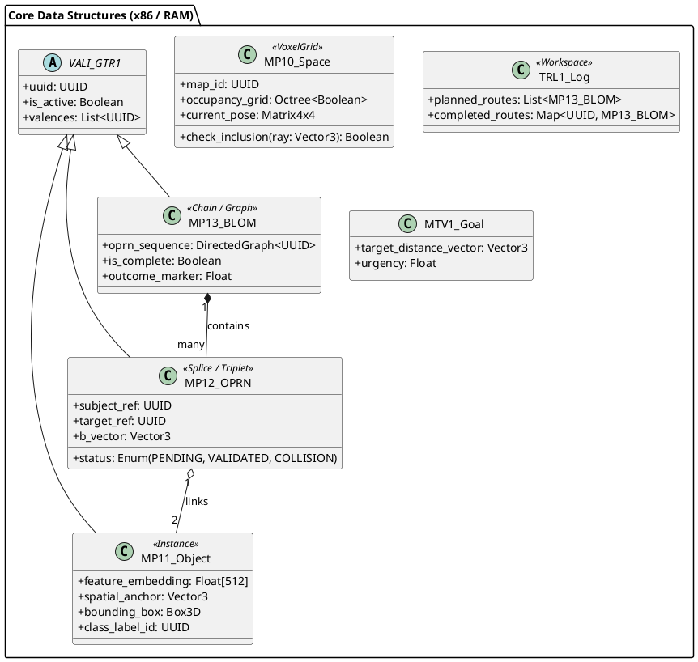
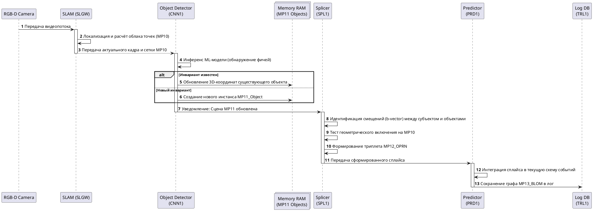
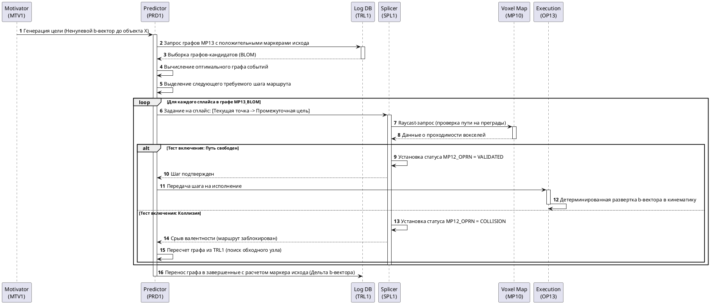

# Спецификация description_GTR1: Философско-архитектурный и технический базис

Данный документ представляет собой фундаментальное описание первой информационно-сенсомоторной трансформации (GTR1) в архитектуре Гативус. Описание предназначено для старта spec-driven разработки на базе классических вычислительных платформ (x86/GPU) и объединяет онтологический смысл с инженерной структурой.

> [!NOTE]
> Данный файл является высокоуровневым (vision) документом. Дальнейшая строгая формализация (UML-диаграммы, бинарные протоколы, точные интерфейсы, SLA и NFR) разбита на задачи в файле `tasks.md` и реализуется в соответствующих подпапках спецификации.

## 1. Философско-онтологическое основание

* **Определение GTR1:** GTR1 — это второй полный цикл трансформаций Гативус (после материального GTR0), который строит поведение в пространстве обитания: путь от координаты «где я» к координате «где цель». Он переводит систему из состояния реактивного пучка рефлексов в режим автономного агента, действующего в познанном мире.
* **Границы реальности GTR1:** Всё, чем оперирует GTR1, жестко привязано к непосредственно воспринимаемому настоящему. Объект должен физически присутствовать на карте, цель — в поле зрения; GTR1 не способен оперировать отсутствующим или небывшим (это граница, которую преодолеет только GTR2 через символ).
* **Рождение Субъекта:** Субъект не является добавленной сверху абстракцией; он возникает на уровне GTR1 как необходимый полюс физического действия внутри триплета «Субъект — Движение — Объект». Субъективный опыт этого уровня — это переживание физического пространства и усилия по обнулению пространственного $b$-вектора.
* **Происхождение Времени:** В архитектуре Гативус время не является пустой сценой. Порядок, возникающий при выстраивании сплайсов в поведенческую схему событий (MP13), и есть само время. Движение порождает время как свою последовательность.

## 2. Архитектурный базис (Сигнатура GTR1)

Система реализует непрерывный замкнутый цикл, основанный на строгом изоморфизме каскадов (база и три уровня над ней). Трансформация двунаправленна и не имеет центрального диспетчера. Выполнение шагов инициируется локально.

* **Прямой ход (DTR - Узнавание/Свёртка):** Движение от сенсорного входа в глубину (от MP10 к MP13). Превращает хаос среды в инвариантные объекты и схемы.
* **Обратный ход (RTR - Порождение/Развёртка):** Движение от принятой цели к физическому действию (от MP13 к MP10). Разворачивает маршрут в моторные акты для обнуления $b$-вектора.
* **Локальность и Валентность:** Порождение происходит асинхронно через класс `VALI` (валентно-инстансная конструкция). Объект с открытыми валентностями (хребет) сам служит заданием для нижележащего каскада, запускающим поиск или создание недостающих элементов.
* **Сенсорный вход:** Видеопоток подаётся исключительно на уровень базы (шлюз SLGW); последующие каскады оперируют только результатами работы предыдущих.

## 3. Диаграмма классов: Структуры и типы данных в RAM

В инженерной реализации на x86/GPU базовая абстракция Гативус (VALI) представлена структурами данных в оперативной памяти.

## 4. Техническая спецификация: Каскады и Пространства (MP/CD)

Трансформация GTR1 состоит из базы и трёх каскадов (CD11, CD12, CD13), где каждый каскад является четвёркой: карта, оператор, тренер, данные (веса).

| Компонент | Онтология Гативус | Структура и Метрика | Роль в реализации (x86/CV) |
| --- | --- | --- | --- |
| **База (MP10 / SLGW)** | Трёхмерная среда обитания, отделяющая твёрдое от полого. | Воксельная сетка (Occupancy Grid). Локализация агента в $SE(3)$. | Оператор Visual SLAM (ORB-SLAM3/RTAB-Map). Привязывает оси к сенсорному потоку. |
| **CD11 (MP11)** | Карта объектов (инвариантов). Переход от континуума проекций к опознанной вещи. | Мультикарта. Точки с эмбеддингами (Тензор `float[512]`), привязанные к MP10. | Объектный детектор (CNN1 - YOLOv8+CLIP). Сравнивает фичи с весами `ND11`. |
| **CD12 (MP12)** | Пространство сплайсов. Триплет OPRN: Субъект — Движение — Объект. | $b$-вектор пространственно-поведенческой связки между двумя UUID. | Синтаксический предиктор (`SPL1`). Выполняет raycasting-тест включения на проходимость пути. |
| **CD13 (MP13)** | Схемы событий (BLOM), порождающие локальное время. Маршруты. | Направленный сетевой граф (`DirectedGraph`), где вершины — экземпляры OPRN. | Семантический предиктор (`PRD1`). Вычисляет авторегрессионный путь (A*) для обнуления вектора. |

## 5. Устройства динамики и управления (Операторы)

Вместо единого центрального процессора, динамику на картах обслуживают специализированные узлы, работающие асинхронно.

* **Мотиватор (MTV1):** Задаёт физиологический вектор-расстояние до цели (например, дистанцию до пищи), который система стремится обнулить.
* **Траекторный лог (TRL1):** Рабочее пространство уровня, агрегирующее опыт. Хранит запланированные, исполняемые и завершенные цепочки (BLOM). Завершенные маршруты получают маркер исхода (числовой вес на базе дофаминовой ошибки предсказания), который используется для переобучения.
* **Предикторы (PRD1 / SPL1):** Семантический предиктор (`PRD1`) выбирает следующую макро-единицу поведения, рассчитывая граф, а синтаксический предиктор (`SPL1`) физически валидирует и замыкает конкретный шаг, обращаясь к геометрии MP10.
* **Операционные сети (OP11, OP12, OP13):** Детерминированные программы на картах. Выполняют трансляцию рассчитанных $b$-векторов в непрерывные кинематические команды. Операционные сети не обучаются; пластичность системы обеспечивается только изменением ядер свёрток (`ND1x`).
* **Тренеры (TRN1, TCH1, SCH1):** Механизмы фонового обновления конфигураций (ядер CNN1 и весов графов) на основе неточности возврата (маркеров исхода из TRL1). Обучение встроено в цикл замыкания и протекает непрерывно.

## 6. Диаграмма последовательности: DTR (Свёртка / Узнавание среды)

## 7. Диаграмма последовательности: RTR (Развёртка / Целеполагание и Исполнение)

