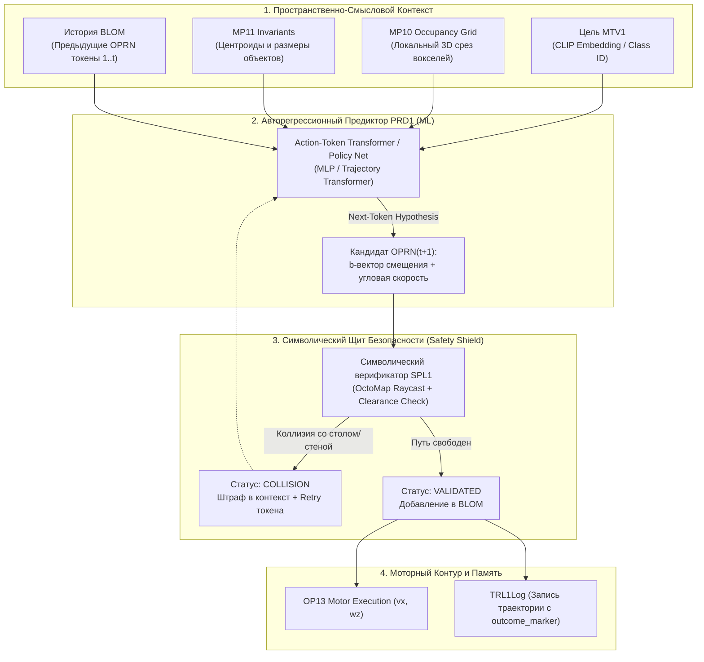

# ISSUE-10: Перенос предиктора PRD1 на авторегрессионную архитектуру генерации токенов действий (Action-Token Transformer & Neuro-Symbolic Function Calling)

| Метаданные | Значение |
| :--- | :--- |
| **Идентификатор задачи** | ISSUE-10 |
| **Категория** | Cognitive Architecture / Reinforcement Learning / Action Tokenization |
| **Приоритет** | **P1 (High)** |
| **Статус** | **OPEN** 📋 |
| **Инициатор** | Пользователь / Архитектурный аудит GTR1 |
| **Связанные компоненты** | `src/operators/prd1_predictor`, `src/core/include/prd1_predictor.hpp`, `src/ml_service`, `src/core/trl1_log` |

---

## 1. Концептуальное обоснование (Motivation & Rationale)

### 1.1. Ограничения текущей реализации (A* Search)
В текущем ядре GTR1 предиктивный планировщик `PRD1` опирается на дискретный алгоритм поиска $A^*$ по 3D-сетке вокселей:
1. **Жесткая привязка к сетке (Grid Artifacts):** Траектории получаются кусочно-ломаными, с резкими углами поворота шасси, требующими сложного сглаживания.
2. **Недостижимость целей на препятствиях (Deadlock):** Если целевой объект (кружка, книга) расположен на столе или тумбе, $A^*$ пытается довести центр шасси робота в координаты объекта. Из-за проверки габаритов корпуса (Clearance Envelope $R=0.22$м) путь бракуется коллизией со столешницей, алгоритм возвращает пустой путь, и робот намертво замирает.
3. **Отсутствие накопления опыта:** $A^*$ каждый раз ищет путь «с чистого листа», игнорируя десятки ранее пройденных успешных траекторий, сохраненных в `TRL1Log`.

### 1.2. Фундаментальная аналогия: Transformer, Function Calling и Action Tokenization
В современных больших языковых моделях (LLM / VLA) внутренняя структура нейросети является сложным неинтерпретируемым пространством весов («черным ящиком»). Однако **выход модели абсолютно прозрачен, типизирован и детерминированно исполняем** — это вызовы функций (**Function Calling / Tool Use**).

В архитектуре **GTR1** цепочка событий **BLOM (Behavioral LOM — поведенческая схема событий)** концептуально представляет собой **последовательность токенов действий (Action Tokens)**:

$$\text{BLOM} = [\text{OPRN}_1, \text{OPRN}_2, \dots, \text{OPRN}_k]$$

Где каждый оператор **OPRN** — это структурированный триплет:

$$\text{OPRN} = \langle \text{Subject: } \text{agent-base}, \quad \vec{b}\text{-vector: } [\Delta x, \Delta y, \Delta z], \quad \text{Target: } \text{waypoint-i} \rangle$$

**Архитектурный сдвиг:** Нам не нужно вручную программировать правила движения робота на каждом миллиметре сетки. Предиктор `PRD1` должен функционировать как **авторегрессионная нейросетевая модель (Action-Token Policy)**, которая на каждом шаге предсказывает **следующий токен действия OPRN**, опираясь на текущую цель, восприятие среды и историю шагов.

---

## 2. Архитектура системы (Neuro-Symbolic Hybrid Architecture)

Решение объединяет гибкость генеративных моделей с жесткими математическими гарантиями безопасности классической робототехники:

### Ключевые компоненты:
1. **Токенизатор пространственных действий (Action Tokenizer):**
   * Квантование или непрерывное представление вектора перемещения $\vec{b} = [\Delta x, \Delta y, \Delta \theta]$ с ограничением шага (например, от 0.2 до 0.5 м).
   * Метаданные токена: тип намерения (`APPROACH_OBJECT`, `BYPASS_OBSTACLE`, `ALIGN_HEADING`, `HOLD_POSITION`).
2. **Нейросетевое ядро PRD1 (Action-Token Predictor):**
   * Легковесный трансформер / MLP-политика (инференс < 5 мс на NVIDIA CUDA), предсказывающий параметры следующего триплета OPRN на основе текущего контекста.
3. **Символический страж (Safety Gatekeeper / SPL1 Splicer):**
   * Принцип **«Trust, but Verify»**: модель может предложить любой вектор, но ни один моторный импульс не отправляется без физической проверки лучами (raycast) в `MP10Space` с учетом габаритного цилиндра робота.
   * Если модель ошиблась и предложила шагнуть в препятствие — токен помечается `COLLISION`, в модель возвращается негативный контекст (аналог ошибки невалидного Function Call в LLM), и запрашивается альтернативный шаг.

---

## 3. Стратегия обучения (Training & Data Pipeline)

### Фаза 1: Обучение поведению (Imitation Learning / Behavior Cloning)
* Использование существующего хранилища `TRL1Log`.
* Экспорт всех успешных траекторий (`outcome_marker >= 0.85`), накопленных на золотом датасете TUM Desk и симуляциях PyBullet.
* Обучение модели предсказывать следующий шаг успешного прохода к цели на основе среза вокселей и текущей позы.

### Фаза 2: Reinforcement Learning (Fine-Tuning с модулями TCH1 и TRN1)
* Модуль **TCH1 (Teacher 1)** вычисляет непрерывную функцию награды:
$$R = R_{\text{goal}} - \alpha \cdot \text{Time} - \beta \cdot \text{Jerk} - \gamma \cdot \text{ProximityToObstacle}$$

* Модуль **TRN1 (Trainer 1)** в фоновом режиме (или в фазе «сна» SCH1) дообучает веса политики методом PPO / DPO, максимизируя маркер исхода и минимизируя процент отвергнутых символическим щитом токенов.

---

## 4. План поэтапной реализации

| Этап | Задачи | Трудозатраты |
| :--- | :--- | :---: |
| **Этап 1: Исправление Stand-off точки в A*** | Внедрить расчет якорной точки остановки перед столом (0.5–0.7 м) и fallback-руление для немедленного устранения замирания робота. | 1 день |
| **Этап 2: Датасет-экспортер TRL1** | Сериализация траекторий `TRL1Log` в пары `(State_Context, Next_OPRN_Token)` в формате PyTorch HDF5/NPZ. | 2 дня |
| **Этап 3: Легковесный сервис Action-Token Policy** | Python-воркер `prd1_model_worker.py` (PyTorch CUDA, порт 5559 ZMQ) с прототипом Trajectory Transformer / MLP Policy. | 3 дня |
| **Этап 4: Интеграция C++ PRD1 и Символического Щита** | Доработка `Prd1Predictor`: опрос нейросетевого сервиса $\to$ валидация через `SPL1` $\to$ исполнение; при сбое нейросети — бесшовный fallback на $A^*$. | 3 дня |
| **Этап 5: UI Инспектор Токенов действий** | Визуализация сгенерированных OPRN-токенов в дашборде Three.js с цветовой дифференциацией (предсказано нейросетью vs проверено щитом). | 2 дня |

---

## 5. Критерии приёмки (Definition of Done)
1. Робот никогда не замирает при обнаружении целевого объекта на столе: строит валидированный подход на дистанцию захвата (0.5 м).
2. Предиктор формирует цепочку BLOM из дискретных токенов OPRN, которые на 100% валидируются символическим щитом `SPL1`.
3. Время генерации одного токена OPRN на Quadro P3200 (CUDA) составляет < 8 мс.
4. Любая попытка модели предложить шаг в препятствие мгновенно отсекается со статусом `COLLISION` без риска аварии.
5. На дашборде Three.js визуализируется полная цепочка BLOM в реальном времени.
