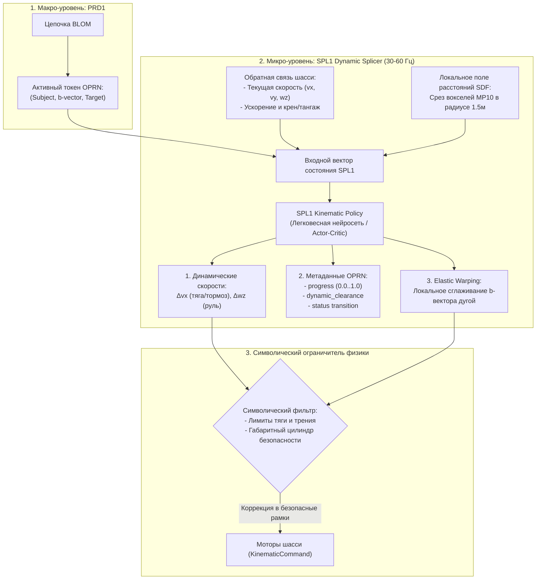

# ISSUE-11: Перенос сплайсера SPL1 на архитектуру предсказания динамических переменных OPRN и управления скоростью (Dynamic Splicer & Kinematic Policy)

| Метаданные | Значение |
| :--- | :--- |
| **Идентификатор задачи** | ISSUE-11 |
| **Категория** | Kinematics / Local Control / Neuro-Symbolic Operators |
| **Приоритет** | **P2 (Medium)** |
| **Статус** | **OPEN** 📋 |
| **Инициатор** | Пользователь / Архитектурный совет GTR1 |
| **Связанные компоненты** | `src/operators/spl1_splicer.cpp`, `src/operators/spl1_splicer.hpp`, `src/core/include/mp12_oprn.hpp`, `src/main.cpp` |
| **Связанные задачи** | [ISSUE-10 (Предиктор PRD1)](ISSUE-10_action_token_predictor.md), [ISSUE-06 (Функция ошибки TCH1)](../issues.md#issue-06), [ISSUE-05 (Цилиндр безопасности)](../issues.md#issue-05) |

---

## 1. Контекст и проблемы текущей реализации

### 1.1. Текущее состояние SPL1 (Splicer)
В текущей реализации класс `Spl1Splicer` выполняет исключительно статическую геометрическую проверку:
1. Вычисляет евклидов вектор $\vec{b} = \text{Target} - \text{Subject}$.
2. Пускает пачку параллельных лучей (`raycast`) в `MP10Space` (OctoMap) на разной высоте корпуса робота.
3. Выставляет бинарный статус: `VALIDATED` (путь чист) или `COLLISION` (есть преграда).

### 1.2. Проблемы разделения логики
* **Эвристическое управление скоростью в `main.cpp`:** Реальный расчет скоростей $v_x$ и $w_z$ сейчас вынесен в `src/main.cpp` в виде жестко закодированных правил:
  ```cpp
  if (std::abs(yaw_err) < 0.35f) {
      vx = std::clamp(0.4f * dist, 0.08f, 0.28f);
  } else if (std::abs(yaw_err) < 0.70f) {
      vx = 0.05f;
  } else {
      vx = 0.0f; // чистый разворот на месте
  }
  ```
  Это приводит к дерганому «тракторному» движению: робот останавливается для разворота на месте, не умеет плавно двигаться по сопряженным дугам и замирает при малейших пограничных значениях угловой ошибки.
* **Отсутствие локальной адаптивности:** Если при движении по прямому сплайсу возникает мелкое препятствие (например, ножка стула или угол стола), текущий SPL1 бракует весь сплайс (`COLLISION`), что вынуждает тяжелый глобальный планировщик `PRD1` пересчитывать всю цепочку событий заново.

---

## 2. Архитектурное решение (Dynamic Splicer & Kinematic Policy)

В двухуровневой когнитивной архитектуре GTR1:
* **PRD1 (Макро-планировщик / ISSUE-10):** определяет *«Куда двигаться»*, генерируя последовательность токенов действий OPRN (цепочку BLOM).
* **SPL1 (Микро-сплайсер / ISSUE-11):** выступает в роли нейро-символического «мозжечка» (Local Kinematic Controller), определяя *«Как именно физически исполнить текущий OPRN»*.



---

## 3. Переменные, за которые отвечает обновленный SPL1

Модуль `Spl1Splicer` переводится из статического валидатора в активный оператор исполнения, оперирующий следующими переменными:

### 1. Кинематические приращения (Kinematic Control Variables)
* $\Delta v_x \in [-a_{\max} \cdot dt, a_{\max} \cdot dt]$: расчет плавного ускорения и прогнозируемого торможения перед препятствием с учетом инерции.
* $\Delta w_z$: расчет кривизны траектории $\kappa = w_z / v_x$ для одновременного движения вперед и поворота по гладким дугам Дубинса/Ридса-Шеппа без остановок.

### 2. Динамические атрибуты структуры `MP12Oprn`
* `progress` $\in [0.0, 1.0]$: непрерывный расчет степени физического прохождения текущего отрезка с интеграцией пройденной дуги.
* `dynamic_clearance`: расчет динамического запаса тормозного пути до ближайшего вокселя на текущей скорости.
* `status`: интеллектуальное переключение жизненного цикла OPRN:
  * `PENDING` $\to$ `VALIDATED` $\to$ `EXECUTING` $\to$ `EXECUTED`;
  * `COLLISION_EVASION` (локальный маневр уклонения при внезапном динамическом препятствии).

### 3. Эластичная сплайс-деформация (Elastic $b$-vector Warping)
* Если прямая линия $\vec{b}$ слегка задевает препятствие (край стола), SPL1 деформирует вектор в сплайн Безье / B-сплайн, локально огибая помеху без сброса глобальной цели и без вызова PRD1.

---

## 4. Символический ограничитель (Hard Constraints Guard)

Выходы нейросетевого контроллера SPL1 на каждом шаге пропускаются через детерминированный защитный барьер:
1. **Кинематические ограничения шасси:**
   $$v_x \le 0.35\text{ м/с}, \quad |w_z| \le 1.0\text{ рад/с}, \quad |a_x| \le 0.8\text{ м/с}^2$$
2. **Гарантия нестолкновения (Safety Envelope):**
   * Расчет положения габаритного цилиндра на шаг $t + \Delta t$. Если дистанция до любого вокселя $< 0.15\text{ м}$, скорость $v_x$ принудительно зануляется физическим предохранителем.

---

## 5. Дорожная карта реализации

| Этап | Задачи | Сроки |
| :--- | :--- | :---: |
| **Фаза 1: Расширение модели `MP12Oprn`** | Добавление полей `progress`, `curvature`, `dynamic_clearance` и методов траекторного трекинга в `mp12_oprn.hpp`. | 1 день |
| **Фаза 2: Сбор датасета гладкого управления** | Запись в симуляторе PyBullet пар `(OPRN, State, Local_SDF, vx, wz)` с гладким сплайновым движением. | 2 дня |
| **Фаза 3: Разработка локальной политики SPL1** | Создание микро-сети (PyTorch / ONNX / LibTorch C++, $< 1\text{ мс}$ на CPU/CUDA) для генерации скоростей и эластичной дуги. | 3 дня |
| **Фаза 4: Интеграция в C++ ядро** | Вынос расчета скоростей из `main.cpp` внутрь `Spl1Splicer::compute_motion(active_oprn, ...)`. | 2 дня |

---

## 6. Критерии приёмки (Definition of Done)
1. В коде `main.cpp` полностью отсутствуют жестко захардкоженные формулы управления скоростью; за расчет $v_x, w_z$ отвечает оператор `SPL1`.
2. Робот совершает развороты и объезды по гладким дугам без полной остановки на месте (отсутствует рывковый характер движения).
3. При появлении локальной преграды на пути $b$-вектора SPL1 локально огибает ее по дуге без вызова тяжелого перепланирования PRD1.
4. Символический фильтр гарантирует 0 столкновений корпуса с препятствиями во всех тестовых сценариях.
